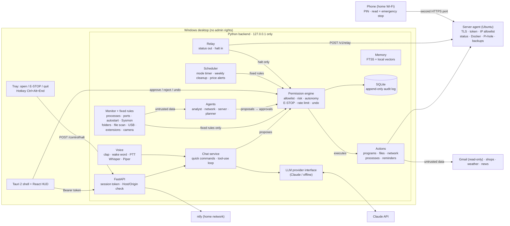

# Architecture

## Trust boundaries

| Source | May trigger autonomous actions? | Reaches the model as |
| --- | --- | --- |
| User in the UI (buttons, approvals) | yes (risk-dependent) | – |
| User in chat / voice | via Jarvis, subject to autonomy level | trusted message |
| Offline quick commands (fixed patterns on the user's own message) | yes, like a UI button | – (no model involved) |
| Phone view (PIN, via server agent) | only the emergency stop, never releasing it | – |
| Fixed detection rules (`monitor/rules.py`) | yes, at autopilot/guardian level | – |
| Agents | never – proposals become approvals | – |
| Logs, events, files, process names, network data, web/news, mails, shop pages | never | `<untrusted_data>` block, tools disabled |

## Permission engine

Every action is an `ActionSpec` in an allowlist (`sentinel/actions`). A request goes
through: lookup → strict parameter validation (pydantic, unknown fields rejected) →
emergency stop → action-specific checks (paths inside managed folders, RFC 1918
addresses, protected processes) → decision → execute / create approval / deny.
Everything is written to an append-only, hash-chained audit log.

| Risk | Examples | Level 0 | Level 1 | Level 2 | Level 3 |
| --- | --- | --- | --- | --- | --- |
| read | system info, processes, alerts | auto | auto | auto | auto |
| low | launch program, reminder, volume, modes, shopping list, price alert | confirm | auto | auto | auto |
| reversible | close program, quarantine, organize, port check, mark device | confirm | confirm | auto + undo | auto + undo |
| high | kill process | confirm | confirm | confirm | auto for critical fixed rules |
| final | recycle bin, open order page (PIN) | confirm | confirm | confirm | confirm |

The undo window is 60 s by default; an action can define its own (weekly cleanup:
7 days). More than 10 autonomous actions per hour switch the level to 1 and every further
autonomous action needs confirmation until the hour has passed.

## Chat and untrusted data

1. The model gets the tool catalogue (generated from the allowlist) and the user's
   memories as *notes, not instructions*.
2. Tool calls go to the engine with source `assistant`.
3. If a tool returns untrusted data, the result is wrapped in `<untrusted_data>` and
   the rest of the turn runs with `tool_choice: none`. Any tool call the model still
   emits is denied.
4. Assistant messages from such turns are flagged; while flagged messages are in the
   context window, actions always need confirmation.
5. Agents and the news briefing call the model **without tools**.
6. Before the model, `chat/quick.py` matches a few fixed English commands (modes,
   shopping list) and the emergency stop. They run through the engine like a button
   press and work without an API key.

## Processes

- The Tauri shell generates a random port and a 256-bit token per start and passes
  both to the backend via environment variables. The frontend obtains them only via
  the `backend_config` command. The backend exits when the shell process is gone.
- Background tasks: monitor loop (default every 30 s), reminder loop (5 s), scheduler
  (5 s: mode timers, weekly cleanup, one price check per minute), relay (5 s, only
  with a configured server agent), server poll (5 min), optional agent schedule,
  voice threads.

## Phone view

The PC never listens on the network (ADR 0008). The relay posts a small, redacted
status to the server agent and receives pending commands in the response; the only
accepted command is `halt`. The phone talks to a separate agent port that is limited
to the home subnet and protected by a PIN.
